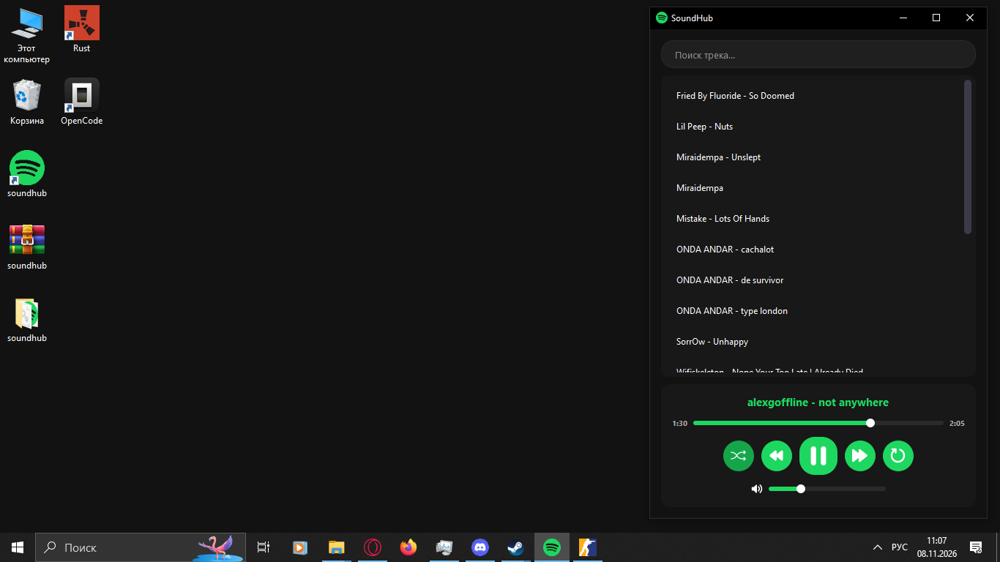

# SoundHub

**A free local music player built with Qt 6.**

SoundHub is a lightweight desktop application for listening to your local music collection. The interface is intentionally simple and focused on essential playback controls.

## Screenshots

## Why SoundHub?

You might notice that the interface is inspired by modern streaming services like Spotify. We believe that a familiar UI is an intuitive UI. However, SoundHub was built to solve a different set of problems:

- **No Subscriptions:** Your music, your rules. No monthly fees, no premium tiers.
- **100% Offline:** No internet connection required. Listen to your local files anytime, anywhere.
- **No Bloatware:** Modern music apps are overloaded with podcasts, audiobooks, social features, and endless menus. SoundHub keeps it simple.
- **Zero Algorithms:** No "Recommended for you", no forced playlists. Just your library.
- **Intent-Based Listening:** Open the app, search for the track you want to hear *right now*, and play it.
- **Lightning Fast:** Built with C++ and Qt 6, the app launches instantly and runs smoothly.

## Features

- Pause and resume playback
- Previous and next track
- Repeat the current track
- Play a random track (shuffle)
- Track search
- Volume control
- Dark UI theme

## How to Add Music

1. Locate the application executable (`.exe`).
2. In the same folder as the `.exe`, find the `music` folder.
3. Place your `.mp3` files or other supported audio files into that folder.

## Important

> **SoundHub does not distribute music.**
> You must download your own music files.

## Project Structure

- `source/` — Application source code
- `music/` — Folder for your local audio files (created automatically or placed next to the `.exe`)

## License

This project is licensed under the MIT License. See the [LICENSE](LICENSE) file for details.

## Credits

SoundHub was developed by **StarleLab** in **2026**.

Website: [https://gplyno.github.io/starlelab/](https://gplyno.github.io/starlelab/)
